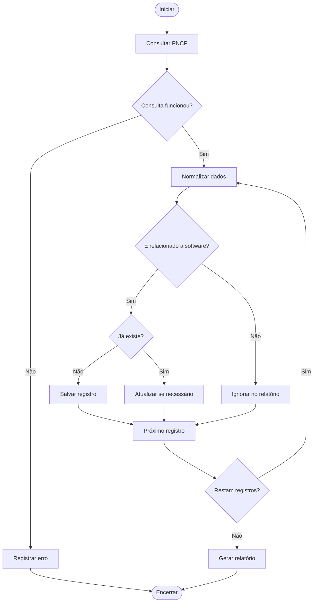

# Regras de Negócio — Projeto 00

Versão: 0.1

## Regras iniciais

**RN-001 — Fonte oficial**

O sistema deve consultar contratações utilizando inicialmente a API pública do PNCP.

**RN-002 — Filtros**

O sistema deve permitir consultas por período e filtragem local por palavras-chave.

**RN-003 — Classificação**

O sistema deve identificar contratações relacionadas a software com base em critérios configuráveis.

**RN-004 — Duplicidade**

Uma contratação não deve ser cadastrada duas vezes quando possuir a mesma identificação oficial.

**RN-005 — Rastreabilidade**

Cada contratação armazenada deve preservar sua identificação, fonte e data de coleta.

**RN-006 — Relatórios**

O sistema deve permitir gerar relatórios das contratações consideradas relevantes.

## Fluxograma

